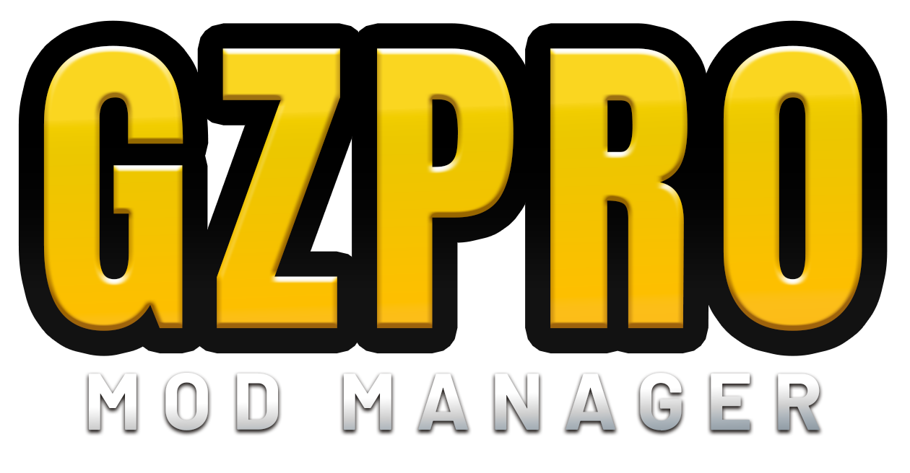

<p align="center">
  
</p>

# GZPro Mod Manager

A small, local-only Windows tool for safely staging pre-cooked `.pak` mods for **Godzilla: Destroy All Monsters Melee Remastered**.

## Run

The project is open source under the MIT License. See [LICENSE](LICENSE). UI controls use human-designed Lucide SVG icons; no AI-generated icons are used. See [THIRD_PARTY_NOTICES.md](THIRD_PARTY_NOTICES.md) for the icon license.

1. For normal use, download and double-click `GZProModManager.exe` from the [latest release](https://github.com/Chickenman456/gzpro-mod-manager/releases/latest). No terminal window or Python installation is required.
2. If the game is installed elsewhere, enter its install folder in the app.

To run from source for development, install Python 3.10 or newer and run `run.bat`.

Some antivirus engines flag unsigned PyInstaller apps as suspicious even when they're safe. The exe uses a PyInstaller bootloader compiled from source to reduce these false positives. You can check what's inside by reading the source and the [build workflow](.github/workflows/build-windows-exe.yml).

The Windows executable runs without opening a terminal and opens in a frameless, resizable desktop window with a custom Steam-style title bar and window controls (using WebView2 when available); if that runtime is unavailable, it falls back to the default browser. Its Windows executable icon is generated from `gzpicon.png`. The header's **Check for updates** button checks the latest stable GitHub release. When a new version is out, it links to the release page so you can download the new exe and replace the old one. Mod backups and settings remain in `%LOCALAPPDATA%\\GZProModManager` and are not replaced by an update.

The launcher includes a **Changelog** tab that reads the latest commit history from this GitHub repository. An internet connection is required to load it.

The manager binds only to `127.0.0.1` and asks Windows for an available local port by default. The packaged desktop version includes pywebview; running from source can use the browser fallback. Managed mods can be enabled or disabled with the checkbox beside each mod; disabled mods appear faded.

## Mod package format (verified working)

Mods install from a single `.zip` containing the cooked IoStore container:

- `<ModName>.utoc` + `<ModName>.ucas` — required; the cooked container holding the mod's assets.
- `<ModName>.pak` — optional companion. If the zip has no `.pak`, the manager deploys a tiny verified stub `.pak` instead: this game only mounts a container when a same-named `.pak` sits next to it. The stub is parsed but never mounted, so its contents never reach the game.

Standard cooked container files must share the same mod name and sit at the zip root. Combined skin-loader packages are also supported: one skin-data folder containing the matching .utoc/.ucas (and optional .pak), plus a GZSkinLoader folder containing Scripts/main.lua and enabled.txt. The skin containers are installed under Paks\\~mods and the loader files under GZPro\\Binaries\\Win64\\ue4ss\\Mods\\GZSkinLoader. The manager enables, disables, and deletes both components together. Root-level README, LICENSE, CHANGELOG, NOTICE, and CREDITS files are ignored; other unexpected paths are rejected unless you approve the supported DLL-install prompt.

### Optional launcher metadata

- Add a root-level `INFO.txt` (UTF-8, up to 16 KB) to show its text as the mod description in the launcher.
- Add one root-level `THUMB.png`, `THUMB.jpg`, `THUMB.jpeg`, or `THUMB.webp` (up to 1 MB) to show a thumbnail beside the mod. The extension must match the image format.
- These files are read by the manager and are not deployed into the game. Both are optional. The launcher also includes a **Report a bug** link to this repository's GitHub issue form.

### Two kinds of mods

**Asset override** (default): for mods that replace existing game assets — music, textures, models. The cooked assets must live at the *same package path* as the originals (e.g. `/Game/Audio/GZ1/Streaming/MENU`). The manager deploys them as `GZPro-<ModName>.pak/.utoc/.ucas` directly in `GZPro\Content\Paks`, which gives the container the same mount priority as the game's own container so the replacement wins. **No UE4SS needed.** Verified working: the menu music was replaced with a cooked SoundWave and plays in-game.

**Blueprint mod**: for UE4SS BPModLoaderMod logic mods (a `ModActor` Blueprint at `/Game/Mods/<ModName>/ModActor`). The manager deploys them as `<ModName>.pak/.utoc/.ucas` in `GZPro\Content\Paks\LogicMods`. **Requires UE4SS** installed separately into `GZPro\Binaries\Win64` (the `dwmapi.dll` + `ue4ss` folder from an official UE4SS release); the manager detects it and warns when it is missing. [Download UE4SS from its official releases page](https://github.com/UE4SS-RE/RE-UE4SS/releases). Choose the regular non-dev release, then follow the [official installation guide](https://docs.ue4ss.com/installation-guide). Verified working: a cooked Blueprint actor mod was deployed by this manager and spawned in-game.

## Current scope and safety

- Accepts `.zip` mod packages containing cooked IoStore files, combined skin-loader packages, or game-root UE4SS layouts. A confirmation prompt can also install DLLs from the ZIP root, `Win64/`, `Binaries/Win64/`, or `GZPro/Binaries/Win64/` into the game's `GZPro/Binaries/Win64` folder. This is an explicit opt-in because DLLs can execute code inside the game. The manager does not inspect code inside DLLs or scripts, so only install packages from sources you trust. A raw WAV or loose `.uasset` cannot be dropped in directly — cook it into a container first.
- Keeps a SHA-256-checked backup of every package under `%LOCALAPPDATA%\GZProModManager`.
- Can disable a managed mod only when every deployed file still matches its saved hash. Re-enabling refuses to overwrite a same-named file that differs.
- Can permanently delete a managed mod and its backup. Deletion first verifies the backup and every installed file; if a file was changed outside the manager, it is left untouched and deletion is blocked.
- Refuses enable/disable/import operations while `GZProSteam-Win64-Shipping.exe` is running.
- Never edits or replaces the game's original `GZPro-Windows.*` or `global.*` archives, and refuses mod names that would collide with them. It can stage UE4SS files only when they are explicitly included in a trusted mod ZIP; it does not download UE4SS separately or manage its global enable/disable state.
- Detects loose `.pak`, `.utoc`, and `.ucas` files in `Paks` and `LogicMods`, groups matching names, and lets you adopt them. Adoption creates a verified backup without changing the installed files; adopted mods can then be disabled and re-enabled. Disable refuses to remove any file whose hash no longer matches the backup.

**Important:** only install mods you trust. The manager verifies file integrity, not mod behavior.

## Tests

Run the standard-library tests with:

```powershell
python -m unittest discover -s tests
```


### Mod profiles (v1.10.0)

Save the current enabled-mod combination as a named profile, then apply it later to enable those mods and disable other managed mods. Deleting a profile does not delete any mods. Applying a profile requires the game to be closed; all mod backups are retained. Manually changing a mod clears the active-profile indicator until a profile is applied or saved again.


### Game launch button (v1.10.0)

The Game Install panel includes a Launch Game button. It starts the configured game executable as a detached Windows process and is disabled if the game is already running or the install is invalid.


### Mod names and updating installed mods

Click a managed mod title to set a display name. This changes only the manager label, not game files. Importing another ZIP with the same mod name offers to replace the existing version. The manager keeps the mod ID and profile references, verifies the old backup and installed files, and restores the previous version if deployment fails.


### UE4SS character packages and troubleshooting (v1.11.0)

Drag a mod ZIP anywhere onto the manager window. In addition to the existing cooked and GZSkinLoader layouts, the manager recognizes game-root UE4SS packages containing `GZPro/Binaries/Win64/dwmapi.dll`, files beneath `GZPro/Binaries/Win64/ue4ss/`, and cooked containers beneath `GZPro/Content/Paks/~mods/`. These files are installed to their matching game-relative locations and included in the mod's verified backup, enable/disable, and delete operations. If the same UE4SS runtime file is already installed with identical contents, the manager reuses it and leaves it in place when the character mod is disabled or deleted. A different existing DLL or runtime file is never overwritten.

The Troubleshooting tab explains common import and installation errors. When an operation fails, the manager displays the likely cause and next step below the error, with a Copy error details action. UE4SS-based character and skin mods for this game require a UE5.8-compatible experimental UE4SS build. The manager can stage files from the package, but it cannot guarantee that third-party DLLs or scripts are safe or compatible.
